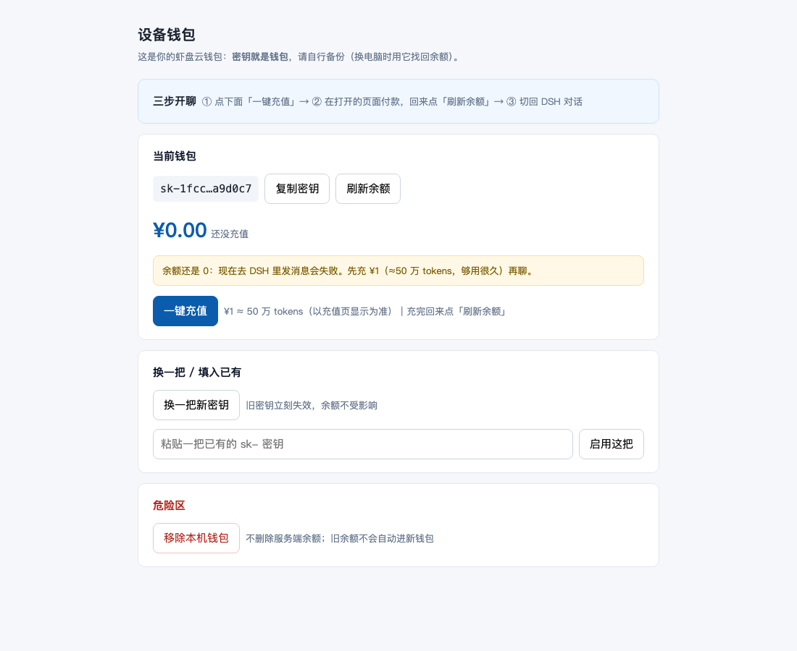

# U-DSH Portable v0.4.3 — 钱包面板体验修好；界面插件留作预览开关

## 一、钱包面板（客户真正会看的那个页面）



- 余额大字显示 **¥0.00**（1 元 = 50 万 token），不再显示让人懵的 `1 tokens`
- 余额为 0 时出现琥珀色提示：**"现在去 DSH 里发消息会失败，先充 ¥1 再聊"**
- 充值按钮旁标单价：`¥1 ≈ 50 万 tokens（以充值页显示为准）`
- 顶部「三步开聊：① 一键充值 → ② 付款后点刷新余额 → ③ 回 DSH 对话」
- 面板改成**固定端口 43110**（方便 DSH 内插件读取），并开了 CORS

## 二、启动器：终端里给可点链接

```
[U-DSH] 余额：¥0.00（1 tokens）
[U-DSH 钱包] 钱包面板：http://127.0.0.1:43110/ （余额 / 充值 / 换 Key，点开即用）
[U-DSH] 已就绪：http://127.0.0.1:49554/?token=…
```

钱包面板现在跟启动器一起起来（不自动开浏览器），点链接就开。

## 三、DSH 界面内嵌钱包：代码写好了，默认不打包

`portable-webui/plugin/` 是一支 DSH 客户端插件（纯 JS、不用打包），目标是在 DSH 界面里加「虾盘云 · 余额/充值」入口。

实测结论（用 CDP 抓真实运行时报错，不靠 curl）：

| 做法 | 结果 |
|---|---|
| 注册进 `conversation.composer.bar` / `conversation.session.header` | ❌ `dsh-client-ui-conversation` 启动失败，整页白屏 `Failed to load plugins` |
| 注册进 `sidebar.brand.name` / `sidebar.panellist` | ✅ 不崩，但会被当成品牌位/空面板列表，显示位置不对 |
| 原样克隆官方 brand 插件（同结构换了内容） | ✅ 正常 → 说明打包/清单没问题，纯粹是**插槽契约**问题 |

插槽的系统没有公开文档，conversation 系插槽的注册契约得照源码推。所以这版**默认不打包插件**（`UDSH_WALLET_PLUGIN=1` 才装），避免把客户界面搞白屏。

## 下载

| 平台 | 文件 |
|---|---|
| macOS | `U-DSH-WebUI-Portable-0.4.3-mac.zip` |
| Windows | `U-DSH-WebUI-Portable-0.4.3-win.zip` |
