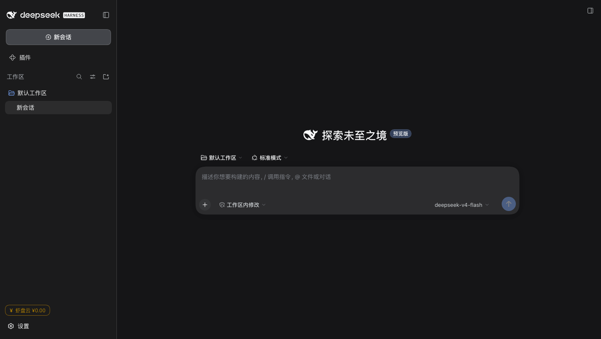

# U-DSH Portable v0.4.4 — 设备钱包进 DSH 界面：左下角「¥ 虾盘云」

## 效果

Dsh 界面**左下角、设置按钮上方**多了一个「¥ 虾盘云 ¥0.00」：

- 实时余额（1 元 = 50 万 tokens），60 秒刷新一次
- 余额为 0 时按钮变琥珀色，提示「点这里充值」
- 点一下直接打开钱包面板：一键充值 / 复制密钥 / 换一把 / 填入已有
- 面板没起来时按钮照常可点（不会让界面报错）

## 怎么做到的（这次踩的坑）

DSH 客户端插件是纯 JS、不用打包，但**插槽契约没有任何文档**。我先后试错：

| 尝试 | 结果 |
|---|---|
| 注册 `conversation.composer.bar` / `conversation.session.header` | ❌ 把 `dsh-client-ui-conversation` 拖挂 → 整页 `Failed to load plugins` |
| 注册 `sidebar.brand.name` / `sidebar.panellist` | ⚠️ 不崩，但显示位置不对 |
| **注册 `sidebar.footer.action`**（契约照抄本地 `dsh-workspace-terminal` 插件） | ✅ 左下角按钮，正解 |

另外修了一个打包级问题：往用户 profile 的 `cordis.patch.yml` 顶层写 `- insert:` 会顶掉 bundle 的插入列表（同样白屏）；正确做法是在**打包时**把插件行追加到 `dsh-web-app` 自己的 `cordis.patch.yml` 里。

打包脚本默认装入插件（`UDSH_NO_WALLET_PLUGIN=1` 可关）。

## 下载

| 平台 | 文件 |
|---|---|
| macOS | `U-DSH-WebUI-Portable-0.4.4-mac.zip` |
| Windows | `U-DSH-WebUI-Portable-0.4.4-win.zip` |
