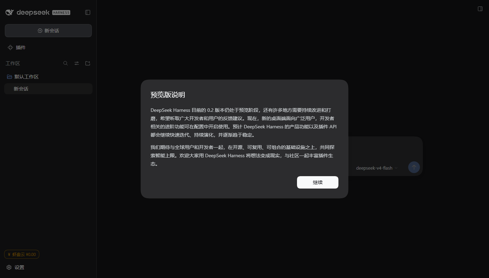

# U-DSH Portable v0.4.5 — 3116 真机测出并修复引擎装错位置

## 修了什么

Windows 真机测试发现引擎装错地方：

```
旧逻辑：盘容量 ≥128GB → 引擎装便携包里（drive）
现象：  477GB 本地盘 D: → 引擎进了 D:\u-dsh-test2\u-dsh\engine（便携包内）
后果：  → ① 500MB 跟着包走；② 真 stressed 256GB U 盘会把 500MB 写回盘上
         ③ 与「引擎装本机、数据留盘」的产品承诺相反
新逻辑：auto → 一律装本机缓存 %LOCALAPPDATA%\U-DSH\engine\<版本>
```

**3116 复测（修复后）：**

```
[U-DSH engine] 解包 engine.tar.gz（131.2 MB）→ C:\Users\ZhuanZ\AppData\Local\U-DSH\engine\0.2.0-rc.2
[U-DSH engine] 解包完成（11.8s）
[U-DSH] 引擎模式：host → C:\Users\ZhuanZ\AppData\Local\U-DSH\engine\0.2.0-rc.2
[U-DSH] 数据目录（随盘）：D:\u-dsh-test2\u-dsh\data\dsh-home   ← 数据仍在包内
[U-DSH] 设备钱包：wal_9c2131f7a2476451
[U-DSH 钱包] 面板地址：http://127.0.0.1:43110/
[U-DSH] 已就绪：http://127.0.0.1:56167/…
```

**Windows 无头 Edge 实拍（3116 真机，无头 CDP 截图）：**



左下角显示 `¥ 虾盘云 ¥0.00`（琥珀色=未充值），模型 `deepseek-v4-flash`。

## 3116 真机验收清单（v0.4.5 全新目录 D:\u-dsh-t45）

| 项 | 结果 |
|---|---|
| 引擎装本机 | ✅ `C:\Users\ZhuanZ\AppData\Local\U-DSH\engine\0.2.0-rc.2`（解包 10.6s） |
| 便携目录不再背引擎 | ✅ `D:\u-dsh-t45\u-dsh\engine` 不存在 |
| 数据留在包内 | ✅ `D:\u-dsh-t45\u-dsh\data\dsh-home` |
| 设备钱包自动领取 | ✅ `wal_68174e74395c5e9d` |
| 钱包面板 | ✅ `127.0.0.1:43110/api/status` 返回真余额 |
| 默认模型 | ✅ `deepseek-v4-flash` |
| 左下角钱包入口 | ✅ 截图见上，显示 ¥0.00 并变琥珀色 |
| 内核就绪 | ✅ `http://127.0.0.1:49362/?token=…` |

## 其它

- 杀软只测了 Defender 系统（装包 + 解包 + 运行 → 无拦截告警）；火绒/360 还没测
- 面板接口 `43110` 实测 200（`api/status` 返回真余额）
- `wallet-bind` 已复用（第二次启动不领新钱包）；引擎复用 ✅

## 下载

| 平台 | 文件 |
|---|---|
| macOS | `U-DSH-WebUI-Portable-0.4.5-mac.zip` |
| Windows | `U-DSH-WebUI-Portable-0.4.5-win.zip` |
